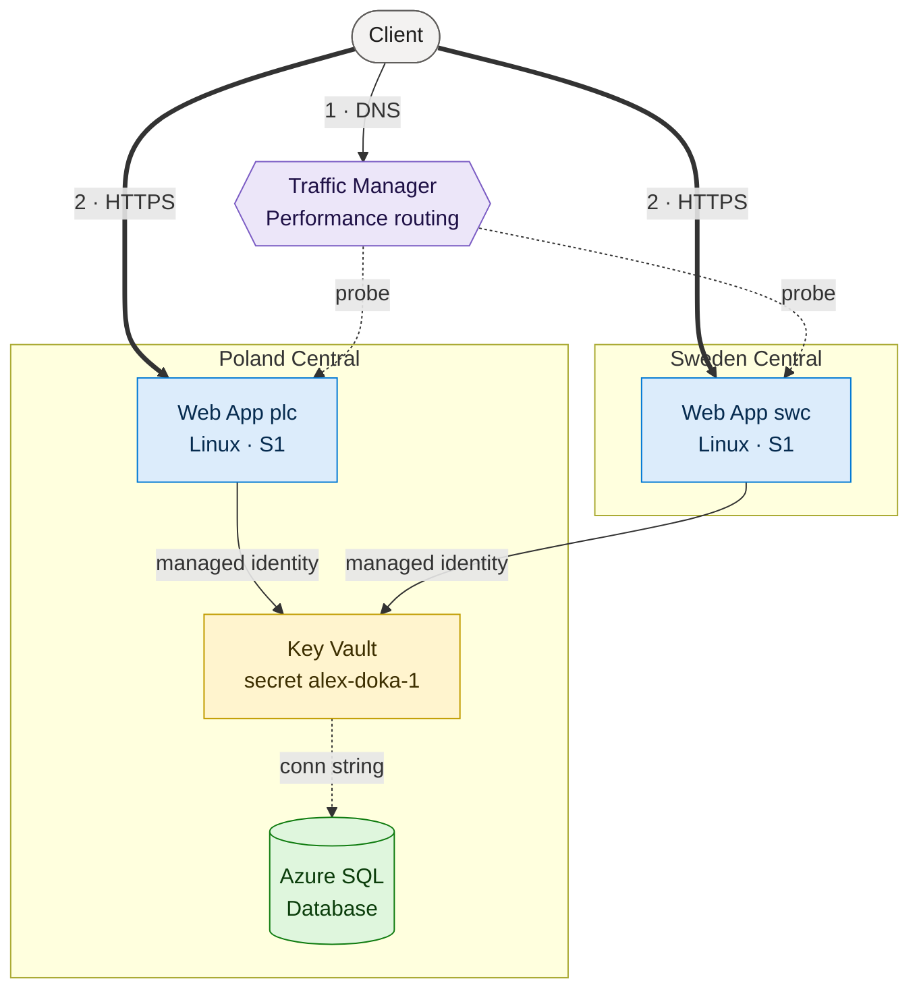
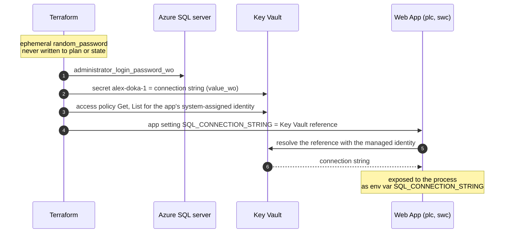

# CloudX 2026 Q3 — Final Task

Terraform configuration for a geo-distributed web application on Azure: two Linux Web Apps in different
regions behind Azure Traffic Manager, reading an Azure SQL connection string from Key Vault through
their managed identities.

## Architecture



### Request flow

1. The client resolves the Traffic Manager FQDN. Traffic Manager is DNS only: with **Performance**
   routing it answers with a CNAME to the healthy Web App with the lowest latency for the client.
2. The client connects to that Web App directly. HTTP is redirected to HTTPS (`https_only = true`).
   The request keeps `Host: tm-…trafficmanager.net`, which App Service accepts because it binds the
   Traffic Manager hostname to every endpoint app automatically.
3. The demo app answers `Region: <location>`, so the response shows which region served it.

Traffic Manager probes every endpoint over HTTPS on `/` every 30 s and takes an endpoint out of
rotation after 3 failed probes. With a DNS TTL of 60 s, clients fail over within a few minutes.

## Where the SQL connection string comes from



The app setting holds a reference, not the secret itself:

```text
@Microsoft.KeyVault(VaultName=kv-cloudx-dev-xxxxxx;SecretName=alex-doka-1;SecretVersion=)
```

- The password is generated by an `ephemeral` resource and passed only to write-only arguments
  (`administrator_login_password_wo`, `value_wo`), so it never appears in the plan or the state.
- An empty `SecretVersion` means "latest": App Service picks up a new secret version without a
  configuration change.
- To rotate the password, bump `sql_password_version`. The same apply writes the new password to the
  SQL server and the Key Vault secret.

## Resources

`xxxxxx` is the first 6 characters of `md5(<resource group ID>)`. It keeps globally scoped names unique
and stays stable between applies.

| Resource | Name | Region | File |
| --- | --- | --- | --- |
| Resource group | `rg-cloudx-2026q3-finaltask-dev` | Poland Central | `main.tf` |
| App Service plans (Linux, S1) | `asp-cloudx-2026q3-finaltask-dev-{plc,swc}` | Poland Central, Sweden Central | `app_service_plans.tf` |
| Linux Web Apps (system-assigned identity) | `app-cloudx-2026q3-finaltask-dev-{plc,swc}-xxxxxx` | Poland Central, Sweden Central | `web_apps.tf` |
| Traffic Manager profile and Azure endpoints | `tm-cloudx-2026q3-finaltask-dev`, `endpoint-{plc,swc}` | global | `traffic_manager.tf` |
| Key Vault, access policies, secret | `kv-cloudx-dev-xxxxxx`, secret `alex-doka-1` | Poland Central | `key_vault.tf` |
| Azure SQL server, database, firewall rule | `sql-cloudx-2026q3-finaltask-dev-xxxxxx`, `sqldb-cloudx-2026q3-finaltask-dev` | Poland Central | `sql.tf` |

All resources are tagged with `env`, `owner`, `cost` and `project` (see `locals.tf`).

## Prerequisites

- Terraform >= 1.11 (ephemeral resources and write-only arguments).
- Azure CLI, signed in with `az login`. The provider authenticates through the CLI.
- The signed-in identity needs:
  - `Contributor` on the target subscription.
  - `Storage Blob Data Contributor` on the state storage account (`use_azuread_auth = true`).
- The remote state backend exists: storage account `alexdokatfstateplatform` in
  `rg-alexdoka-platform-shared`, container `learn`.

## Usage

```bash
terraform init
terraform plan
terraform apply
```

Values for the `dev` environment live in `terraform.dev.auto.tfvars` and are loaded automatically.

## Verification

```bash
RG=$(terraform output -raw resource_group_name)
FQDN=$(terraform output -raw traffic_manager_fqdn)

# Which app the client is routed to.
dig +short "$FQDN"

# Region that served the request. -k: see "Notes" about the certificate.
curl -sk "https://$FQDN/"

# Endpoint health as seen by Traffic Manager.
az network traffic-manager endpoint list -g "$RG" --profile-name tm-cloudx-2026q3-finaltask-dev -o table

# Key Vault reference in the app settings and its resolution status.
APP=$(az webapp list -g "$RG" --query "[0].name" -o tsv)
az webapp config appsettings list -g "$RG" --name "$APP" --query "[?name=='SQL_CONNECTION_STRING']"
```

In the portal: **Web App → Settings → Environment variables → App settings**. The **Source** column of
`SQL_CONNECTION_STRING` shows **Key vault Reference** with a green check mark.

Failover test: stop one app with `az webapp stop`, wait until its endpoint turns `Degraded`, flush the
local DNS cache and request the FQDN again. The other region answers.

## Inputs

| Variable | Description |
| --- | --- |
| `subscription_id` | Azure subscription ID. |
| `project`, `environment` | Used in resource names and tags. |
| `owner`, `cost_center` | Tag values. |
| `primary_location` | Region of the resource group, Azure SQL and Key Vault. |
| `app_service_plans` | Map of plans (`location`, `sku_name`, optional `os_type`). One Web App is created per plan. |
| `sql_database_sku`, `sql_database_max_size_gb` | Azure SQL Database size. |
| `key_vault_name_prefix`, `key_vault_sku_name` | Key Vault name prefix and SKU. |
| `sql_connection_secret_name` | Name of the Key Vault secret with the connection string. |
| `sql_password_version` | Bump to rotate the SQL admin password. |
| `traffic_manager_routing_method`, `traffic_manager_dns_ttl` | Traffic Manager routing and DNS TTL. |

## Outputs

| Output | Description |
| --- | --- |
| `resource_group_name` | Name of the main resource group. |
| `traffic_manager_fqdn` | Public entry point of the application. |

## Notes

- **Plan tier.** App Service serves the Traffic Manager hostname only on Standard (S1) or higher. On
  Basic the endpoint is created and reports `Online`, but requests through Traffic Manager return
  `404 Web Site not found`.
- **Hostname binding.** App Service binds `tm-…trafficmanager.net` to the app by itself when the
  endpoint is added, and the binding can be removed only through Traffic Manager. Do not manage it
  with `azurerm_app_service_custom_hostname_binding`.
- **Certificate.** HTTPS on `*.trafficmanager.net` is served with the default `*.azurewebsites.net`
  certificate, so browsers show a name mismatch warning and the portal shows the domain as
  `No binding`. For production, map a custom domain (CNAME to Traffic Manager) on both apps and bind
  a certificate to it.
- **Key Vault access** uses access policies, as the task requires, not Azure RBAC.
- **SQL firewall.** The `0.0.0.0` rule allows connections from any Azure service, including other
  tenants. For production, use VNet integration and a private endpoint.
- **Demo app.** A one-line Node.js server from the `APP_CODE` app setting, so no code deployment is
  needed. It does not query the database.
- **Learning stand.** Key Vault soft delete retention is 7 days and purge protection is off. The two
  S1 plans are the main cost, so run `terraform destroy` when you are done.
